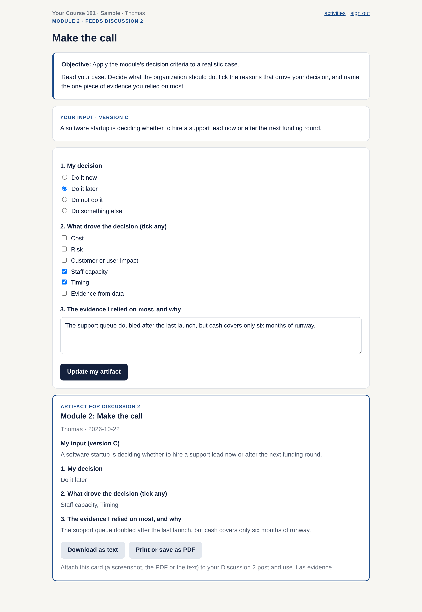
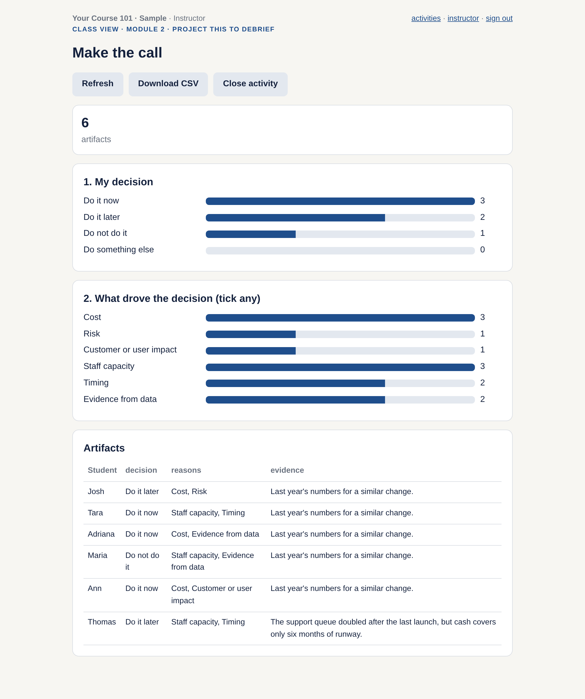

# 6. The starter web app (optional)

A small Python (Flask) app in [`starter-app/`](../starter-app/). It does four things:

1. **Students log in** with a username and password from your roster.
2. **Each activity is a short form** defined in one file, [`starter-app/course.py`](../starter-app/course.py). You edit text, not code.
3. **Each student gets an artifact card** to attach to the discussion post: a screenshot, a PDF (print) or a text download. If an activity has variants, each student gets their own input, the same one every time they open it, live or from the recording.
4. **You get a class view** to project and debrief: bar charts for every choice, every artifact in one table, a CSV download, and an open/close switch per activity.

Each student sees only their own work.

| Student: the activity and the artifact card | Instructor: the class view |
|---|---|
|  |  |

## Run it on your computer (10 minutes)

You need Python 3.10 or newer.

```bash
cd starter-app
python -m venv .venv
source .venv/bin/activate          # Windows: .venv\Scripts\activate
pip install -r requirements.txt
python app.py load-roster roster_sample.csv
python app.py
```

Open http://localhost:5000 and sign in as `thomas` / `apple` (student) or `instructor` / `change-me` (instructor).

Run the tests: `python -m unittest discover tests`

## Make it yours

1. **Course name and activities:** edit `course.py`. Each activity has a title, the existing objective, the discussion it feeds, a short intro, optional variants (one input per student) and its fields. Field types: `short`, `text`, `choice`, `checks`.
2. **Roster:** make a CSV with `username,password,name,is_admin` and load it with `python app.py load-roster roster.csv`, or upload it from the instructor's Roster page. Give students passwords made for this app only; never use a student ID number or a university password.
3. **Look:** colors and fonts are in `static/style.css`.

## Put it online

Any host that runs a Python web app works. Two common choices:

- **Render** or **PythonAnywhere:** connect your copy of this repo, set the start command to `gunicorn app:app` (from `starter-app/`), and set `SECRET_KEY` to a long random string.
- **Your university's server:** ask IT for a small Python app host.

Two things to check before the first class:

- **Keep the data.** The app stores data in SQLite at `data/app.db` (or `DATABASE_PATH`). On free hosting plans that file can be wiped on every restart or redeploy. Use a persistent disk, or download the CSVs after each class.
- **Privacy.** Store only what the activity needs. Do not put grades or student ID numbers in the app.

## When you outgrow it

MET AD 599 started as a Flask app like this one and now runs as a static site on GitHub Pages with a hosted database (Supabase), with one route per week (`/w01/` to `/w06/`). That setup has no server to keep alive, but it takes more work to build. Start with the starter app; move only if you need to.
