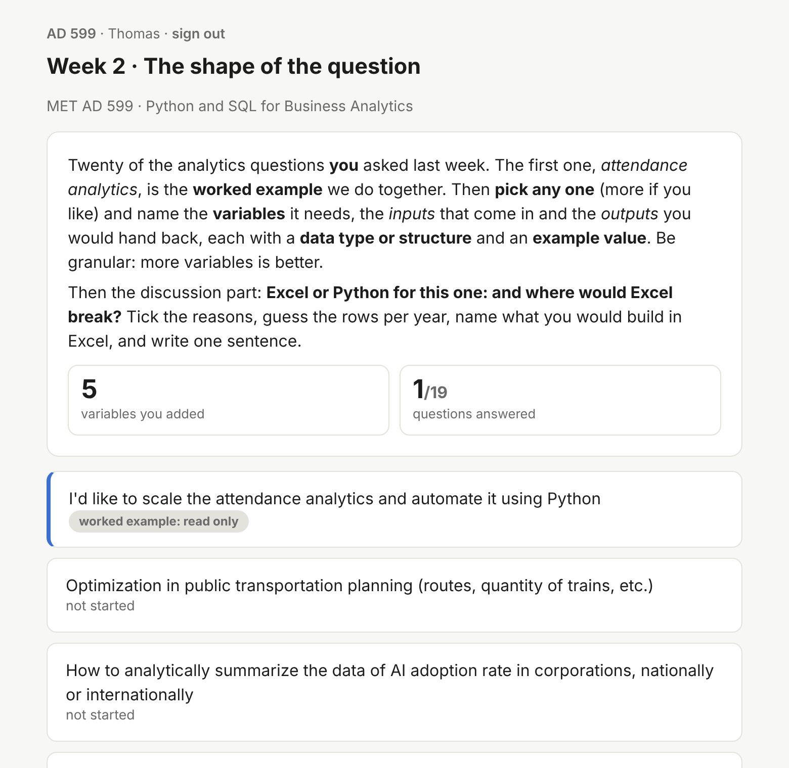
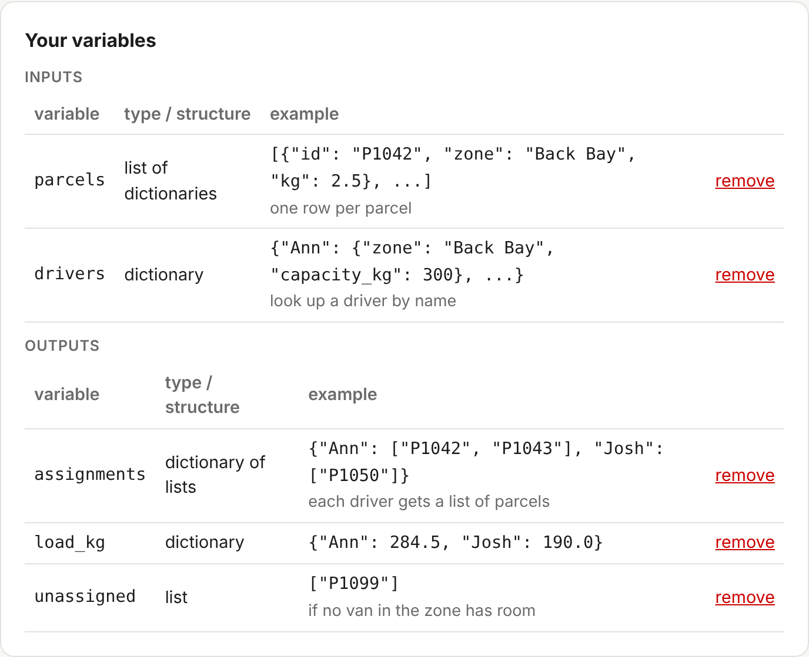
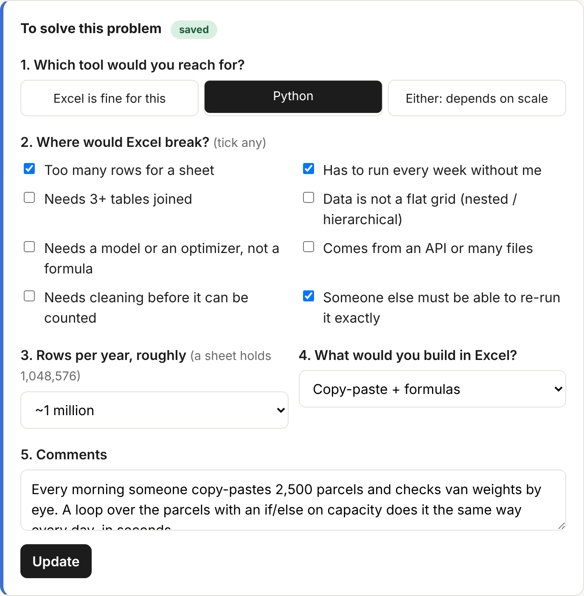
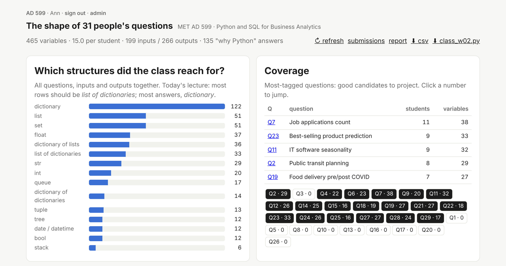

# Walkthrough: how /w02/ feeds Discussion 2

Screens come from a test copy of the AD 599 app with sample data. No real student data is shown.

## Step 1: students start from their own questions

The list is the analytics questions the class asked in the Week 1 survey. The first one, attendance analytics, is a worked example done together on the slides. Each student then picks a question and builds the artifact for it.

## Step 2: the artifact, variables plus a verdict

A student picked "Amazon deliveries are decided manually every day; automate it with Python and SQL." They name the inputs and outputs with a data type and an example value:

Then they decide "Excel or Python?", tick where Excel breaks, estimate the rows per year, name what they would build in Excel, and write one sentence:

## Step 3: the class view, live

Students see only their own work. The instructor projects the class view to debrief before students post.

## How the artifact answers the Discussion 2 prompt

> In Python, conditional statements and loops are essential for program control. Think of a business scenario (e.g., credit scoring, dynamic pricing, or fraud detection) where if/else logic or loops could be used to automate decision-making. Describe how the logic would work and why Python is a suitable tool.

| Discussion 2 asks | The /w02/ artifact already has |
|---|---|
| A business scenario to automate | The student's own question from the Week 1 survey |
| How the if/else and loop logic works | Inputs and outputs, typed: parcels and drivers in; assignments, load per van and unassigned parcels out |
| Why Python is a suitable tool | Too many rows, runs every week, must re-run exactly; copy-paste in Excel becomes a loop with an if/else on van capacity |

The activity is the **Comprehend** step: students leave class with a filled card for a real question. The discussion post is the **Demonstrate** step: they explain the scenario, the logic and why Python, using that card, and replies compare verdicts.
